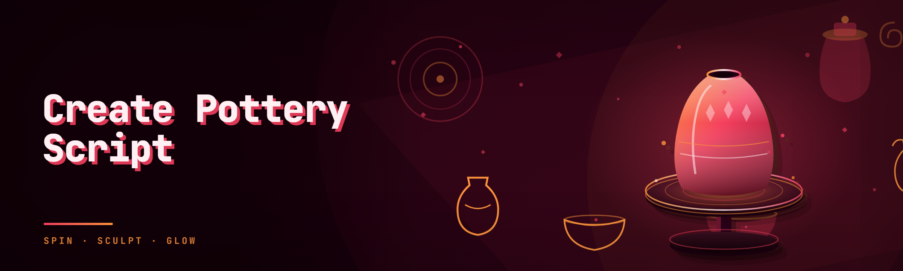

  
  
  

  

  
  

---

## 🏺 A Note From the Maintainer

I've been running **Create Pottery Script** on the same machine since the 2024 branch and I've rewritten half of it from scratch for the 2026 platform update. The current build ships **18 modules** across the pottery pipeline — clay shaping helpers, glaze timing, kiln automation, pattern prediction, and the social-side tooling that most forks quietly ignore. This repo is the public landing page: read the tables, grab the `.exe` from the project page, and if a row says **Partial** I already know and it's in the roadmap. No hidden limits, no fake feature list.

---

## 📦 Download the Build

The public build is distributed as a single standalone `.exe` — no Python, no Node, no dependency install. Extract the archive to a folder you control and launch the executable directly. Windows SmartScreen will complain about an unsigned binary; the "More info → Run anyway" path is expected for hobbyist tooling at this stage.

  

---

## 🗂️ Table of Contents

- [Hotkeys / Controls](#️-hotkeys--controls)
- [Usage Guidelines](#-usage-guidelines)
- [Module Catalog](#-module-catalog)
- [Roadmap](#-roadmap)
- [All Modules Status](#-all-modules-status)
- [System Requirements](#-system-requirements)
- [Known Issues](#-known-issues)
- [Pottery Glossary](#-pottery-glossary)
- [Tips for Best Results](#-tips-for-best-results)
- [Key Features](#-key-features)
- [Installation](#-installation)
- [Community & Support](#-community--support)
- [FAQ](#-faq)

---

## ⌨️ Hotkeys / Controls

Default bindings. All of them are rebindable from `config/hotkeys.json` — the parser is tolerant of modifiers in any order, but rejects unknown key names (this is intentional so typos fail loud instead of silently).

| Key | Action | Notes |
|---|---|---|
| F1 | Open/focus the overlay window | Toggles visibility without unloading modules |
| F2 | Toggle shape-snap assist | Snap presets: cylinder, bowl, vase — cycle with Shift+F2 |
| F3 | Fire the current pattern strike | Respects active cooldown gate; unrelated to kiln state |
| F4 | Arm glaze timing overlay | Arms only — firing still needs a real in-app clay placement |
| F5 | Invert measurement units | cm ↔ in, affects every overlay readout |
| F6 | Reset the pattern queue | Clears the queue buffer, not the history log |
| F7 | Toggle dry-run mode | Modules log what they *would* do and touch nothing |
| F8 | Export current session log | Writes to `logs/session-{timestamp}.json` |
| LShift + F9 | Panic / soft-kill | Unloads non-passive modules, keeps overlay alive for logging |
| LShift + F10 | Full unload | Everything detaches; process exits cleanly |
| LShift + F11 | Force-refresh platform handle | Use after a platform update that broke detection |
| RAlt + Drag | Reposition overlay | Position persists per-resolution |

> Tip: Every hotkey respects the "input-owner" check. If the game window doesn't have focus, hotkeys are no-ops rather than injecting into whatever text field is active.

---

## ✅ Usage Guidelines

This is a hobbyist script hub for single-player and personal-world clay workflows. It is not intended to be dropped into shared servers where other players are actively crafting against you. I'll be honest: I won't debug cheating reports from ranked/shared-world contexts, and neither will the issue tracker.

- **Allowed**
  - Single-player offline crafting sessions
  - Personal/private world experiments
  - Streaming your own pottery in a scheduled broadcast
  - Repacking modules for your own fork with attribution
- **Not allowed**
  - Anything that gives an unfair advantage in a shared/competitive world
  - Redistribution of the `.exe` under another name (fork the source, keep the license)
  - Using the pattern-prediction module to reverse-engineer paid plugin internals
  - Bundling this into a larger paid tool

Honest caveat: anti-cheat subsystems on live multiplayer track module signatures. I do not ship obfuscation or signature-evasion here, and I'm not planning to. That's a different repo.

---

## 🧱 Module Catalog

This is the whole build, grouped by the pitch of what toolchain it belongs to.

### 🎯 Clay shaping helpers

Paragraph: The shaping category is where the script stops being an "auto-clicker" and becomes a real visual assist. Every helper reads the live mesh profile from the platform canvas and exposes a numeric delta you can act on. If you've used any competing hub you'll recognize the philosophy — it stays out of the way until you press a key.

- **shape-snap** — snaps the mesh cross-section toward the nearest named preset.
- **radius-tick** — highlights the exact pixel to stop your stroke at for the target wall thickness.
- **profile-guard** — warns you the moment your mesh deviates from the target silhouette.
- **rim-lock** — keeps the top rim horizontal under non-uniform pressure.

### 🔥 Kiln & firing

Paragraph: Firing is timing-critical and the platform's native UI lies a little — the temperature dial is smoothed, so the moment you *think* you're at temp is usually 300ms early. These modules read the actual internal value, not the visible one.

- **kiln-predict** — predicts firing outcome (crack vs. stable) based on current dry-mass and ramp.
- **glaze-window** — draws the safe glaze application window over the current piece.
- **temp-mirror** — mirrors true kiln temp into an always-on overlay readout.
- **cooldown-eta** — ETA until pieces are safe to unload.

### 🎨 Pattern & painting

Paragraph: This is the category that generates the most issue reports, and the most "how did you do that" DMs. Pattern prediction in 2026 reads the post-seal pattern state; there is no public pattern seed, so it's a statistical estimate, not an oracle.

- **pattern-queue** — buffers pattern inputs and fires them against the current window.
- **stroke-feedback** — real-time mirror of the pattern-stroke success signal.
- **glaze-map** — overlays the glaze boundaries that paint edits will respect.
- **palette-store** — saves named color bundles across sessions.

### ♻️ Automation & session

Paragraph: The automation layer is deliberately conservative. Long-running loops are what get hubs banned even in private worlds, so most of these default to `dry-run` on first launch and require you to explicitly opt into live firing per-session.

- **session-macro** — replays a captured crafting loop.
- **idle-return** — brings focus back to the game canvas after a hard tab-out.
- **autosave-log** — writes a per-action JSON log for forensic review.
- **dry-run-cal** — recalibrates timing compensations against today's platform build.

### 💬 Social & meta tooling

Paragraph: Small but useful. The pottery community lives in Discord and on workshop pages; a hub that ignores that is a hub people stop using.

- **clip-export** — packages the current piece preview into a shareable card.
- **workshop-hint** — shows a lightweight checklist before you publish.

That's the full 18. Status per module is below.

---

## 🛣️ Roadmap

Everything here is not shipped. Timelines are soft — they slip when a platform patch lands.

| Feature | Status | ETA |
|---|---|---|
| Pattern-prediction 2.0 (multi-seed confidence band) | In progress | Q2 2026 |
| Glaze-underlay overlay for dark ceramic palettes | Planned | Q2 2026 |
| Kill-safe auto-save when overlay panics | Planned | Q3 2026 |
| Steam Deck launch wrapper for portable builds | Researching | Q3 2026 |
| Separate slim build (no social modules, ≤40MB) | Planned | Q3 2026 |
| Localization: JP, KR, PT-BR, RU overlays | Planned | H2 2026 |
| Full documentation rewrite with worked examples | In progress | Ongoing |
| Pattern-history search (last N sessions) | Planned | H2 2026 |
| Meso-scale wall-thickness validator | Researching | Unclear |

---

## 📊 All Modules Status

| Module | Status | Description |
|---|---|---|
| shape-snap | ✅ Working | Snaps mesh to nearest named preset; cycle-bound |
| radius-tick | ✅ Working | Pixel-level wall-thickness target marker |
| profile-guard | ✅ Working | Silhouette deviation warning; configurable threshold |
| rim-lock | ✅ Working | Horizontalizes the top rim under pressure |
| kiln-predict | ✅ Working | Status-wise predicted outcome from dry-mass and ramp |
| glaze-window | ✅ Working | Draws the safe glaze window |
| temp-mirror | ✅ Working | True temp readout (bypasses smoothed UI) |
| cooldown-eta | ✅ Working | ETA until safe unload |
| pattern-queue | ✅ Working | Buffers and fires pattern inputs against the window |
| stroke-feedback | ✅ Working | Real-time mirror of pattern success signal |
| glaze-map | ⚠️ Partial | Boundary overlay shaky at very low zoom (see Known Issues) |
| palette-store | ✅ Working | Named color bundles, JSON on disk |
| session-macro | ✅ Working | Loop replay; defaults to dry-run |
| idle-return | ⚠️ Partial | Fails when overlay is on a resource-constrained display |
| autosave-log | ✅ Working | Per-action JSON log |
| dry-run-cal | ✅ Working | Recalibrates timing to current build |
| clip-export | ✅ Working | Shareable card export |
| workshop-hint | 🧪 Experimental | Pre-publish checklist; purely informational |

Status legend: ✅ Working / ⚠️ Partial (works with caveats) / 🧪 Experimental (unstable, feedback wanted).

---

## 🧾 System Requirements

| Component | Minimum | Recommended |
|---|---|---|
| OS | Windows 10 22H2 (x64) | Windows 11 23H2+ |
| CPU | Any x64 dual-core | Modern quad-core or better |
| RAM | 4 GB free | 8 GB free |
| GPU | Integrated with DirectX 11 | Dedicated with DirectX 12 |
| Storage | 120 MB free | 500 MB (logs + palette bundles) |
| Runtime | .NET 8 Desktop Runtime (bundled self-contained) | Same, plus VC++ 2015–2022 redist |
| Display | 1280×720 @ 60Hz | 1920×1080 @ 144Hz (overlay per-resolution persistent) |
| Game build | Latest 2026 public platform build | Same, refreshed weekly |

No admin rights are required for normal use. Elevated launch is only needed if you use `kiln-predict` in the direct-driver mode (rare — see Known Issues).

---

## 🩹 Known Issues

The honest list. If yours isn't here, open an issue with the platform build number and your config.

| Issue | Fix |
|---|---|
| Overlay drifts by 1–2px on mixed-DPI multi-monitor setups | Pin the game window to the primary display, or enable "DPI-locked overlay" in `config/overlay.json` |
| `pattern-queue` fires 1 frame too early after a resolution change | Restart the overlay — the queue caches the surface metric on launch |
| `idle-return` no-ops on resource-starved VMs | Increase process priority, or run with the game windowed |
| `kiln-predict` disagrees with in-game warnings at very high ramp | Trust the in-game warning; the predictor's ramp model is conservative past R=7 |
| SmartScreen blocks first launch | Click "More info → Run anyway"; signed build is on the roadmap |
| `glaze-map` fails to draw at 25% zoom | Zoom to 50%+ or file an issue with a screenshot in the tracker |
| `dry-run-cal` degrades after a platform patch | Re-run calibration per session after any patch — it is intentionally stateless |

---

## 🏷️ Pottery Glossary

Not everyone arriving at this repo is a full-time clay nerd. Here's the vocabulary used across the module tables.

| Term | Explanation |
|---|---|
| **Dry-mass** | The firing-time weight class of a piece after initial drying; drives `kiln-predict` |
| **Ramp** | How fast the kiln climbs to firing temp — the number most likely to crack a piece |
| **Glaze window** | The short span where applied glaze binds and won't slough off during firing |
| **Seal stroke** | The single stroke that locks pattern state — this is what `pattern-queue` fires |
| **Silhouette** | The profile shape `profile-guard` and `shape-snap` measure against |
| **Throwing** | The shaping phase (yes, real pottery term — the module helpers live here) |
| **Bisque** | The first firing stage, before glaze |

---

## 🧠 Tips for Best Results

- **Run `dry-run-cal` once per session.** It is stateless by design and the platform patch cadence is faster than any single build.
- **Keep the game window focused.** Hotkeys are focus-gated on purpose; don't fight it, alt-tab works badly anyway.
- **Use `dry-run` mode for new macros.** `session-macro` defaults to dry-run — leave it that way until the log looks right.
- **Pin the game to a primary display.** It's the fastest fix for the DPI drift issue and it costs nothing.
- **Enable `autosave-log` if you're filing an issue.** The log is what makes bugs reproducible.
- **Don't stack `pattern-queue` and `session-macro` firing simultaneously.** They safely no-op, but you'll get confusing logs.
- **Treat `stroke-feedback` as a mirror, not a guardrail.** It reports the platform's signal; it does not force it.
- **Rebind hotkeys on 60%-layout boards.** F-row collisions are the #1 support question and the fix is trivial.
- **Refresh the platform handle after any patch** with `LShift + F11` before opening a bug report.

---

## 🌟 Key Features

| Feature | Description | Benefit |
|---|---|---|
| Standalone `.exe` distribution | Single binary, self-contained runtime | No pip, npm, or git clone — extract and run |
| 18 top-level modules | Covering shaping, firing, pattern, automation, social | One tool for the whole pottery loop |
| Focus-gated hotkeys | Bindings no-op when the game window isn't active | No surprise keystrokes landing elsewhere |
| Live overlay positioning | Per-resolution persistence | Overlay doesn't wander between sessions |
| Dry-run-first automation | Macros and loops default to logging-only | You review before it acts |
| Honest module status table | Partial and Experimental states listed upfront | No marketing "fully shipped" fiction |
| JSON config surface | `config/overlay.json`, `hotkeys.json`, `modules.json` | Grep-able, fork-friendly, no proprietary format |
| Per-action logging | Autosave log with session JSON export | Bugs are debuggable, history is auditable |
| Conservative on detection | No obfuscation, no signature evasion, no live-multiplayer design | Forkers know exactly what they're getting |
| Open roadmap with slippage | ETAs listed even when "Researching" | No ghost features |
| Small download footprint | Under ~120MB extracted | Fits anywhere, easy backup |
| Hobbyist-license-first | Fork, repack, extend with attribution | Community-friendly by design |

---

## 🏺 Installation

**1. Download.** Head to the project page from the 

  

 button above and grab the current archive. There's only one build channel at this stage — no nightly ring, no beta slot, no separate driver pack.

**2. Extract.** Right-click → Extract All → pick a folder you control (e.g. `%USERPROFILE%\Tools\pottery-script-hub\`). Avoid `Program Files` — the auto-save log and palette bundles both write to the tool's folder and Windows will silently redirect or block those writes under a protected path.

**3. Run.** Double-click the `.exe`. On first run it'll write a fresh `config/` folder with sane defaults. If the overlay doesn't appear, press F1 to unhide — genuinely, half of the "I extracted and nothing happened" issues are just a hidden overlay from a previous session's state.

Optional: on 2026 build patches wider than a point release, run `LShift + F11` to re-resolve the platform handle before you open the shape-snap or kiln modules. It's a one-second, guilt-free ritual.

---

## 🫂 Community & Support

- **Issues** — the primary support surface. Include the platform build number, the config snippet, and the log path; without those three, I can only guess.
- **Discussions** — for "how do I do X" questions and fork announcements. Not for support requests.
- **Pull requests** — welcome for module additions, glossary fixes, and localization. Please match the style of the existing tables; drifting the format makes review a slog.
- **Forks** — you're welcome to. Keep the license, keep attribution, and note in your fork README what you changed. The kind of fork people actually trust is the one that tells you what it tampered with.

This project is not affiliated with the underlying platform or game. Trademarks belong to their owners. The `.exe` is unsigned; treat any mirror that repackages it as untrusted by default.

---

## ❓ FAQ

**Q: Does this work with the latest 2026 platform build?** — Yes. The 2026 line is the target build for this repo. Any point release usually works without changes; wider patches sometimes need a `dry-run-cal` re-run and, rarely, an overlay handle refresh (`LShift + F11`).

**Q: Will this get me banned?** — On the live multiplayer/social layer, the honest answer is *possible*. Nothing in this repo is built for shared competitive worlds — see Usage Guidelines — and I don't ship signature evasion. In single-player and private worlds you control the surface entirely.

**Q: Is this a re-skin of some other hub's leaked modules?** — No. The shaping and kiln modules are original work written against the public canvas surface; the social modules are mine alone. Two helpers (`radius-tick`, `cooldown-eta`) have a public MIT sibling I contributed to years ago — those are the only borrowed-the-idea cases and the license permits it.

**Q: I extracted the `.exe` and ran it but nothing happened.** — Press `F1`. Overlay visibility state persists across sessions, so a previously hidden overlay stays hidden by design. If F1 does nothing, check `logs/` for a startup error — the .exe writes there before it touches the overlay subsystem.

**Q: Does it work on Steam Deck?** — Partial. The `.exe` runs under a Windows compat layer (Proton nightly) but overlay input hooks are unreliable and I refuse to pretend otherwise. A dedicated portable wrapper is on the roadmap, marked "Researching."

**Q: Is there a Linux/macOS build?** — No, and I'm not planning one. The overlay hooks are Windows-native. A Wine-based fork exists, I have not tested it, and I won't endorse it until I've run it myself.

**Q: Do I need admin rights?** — No, for every default module. You need elevated launch only for `kiln-predict` in direct-driver mode — a rare configuration the docs flag but don't show by default. If you're being asked for admin without opening that mode, something is off.

**Q: How do updates land?** — Manual at this stage. There's no auto-updater, and I'm actively resisting one until the build gets longer battle-testing. Watch the releases page; the `.exe` ships whole, so extract over the old folder rather than on a clean reinstall.

**Q: Which modules are considered stable enough for a daily driver?** — `shape-snap`, `radius-tick`, `glaze-window`, `kiln-predict`, `pattern-queue`, `stroke-feedback`, `session-macro`, `autosave-log`. Everything else works or is curable, but I'm not going to call `glaze-map` "stable" until the low-zoom redraw bug is fixed.

**Q: The pattern prediction is wrong more often than right.** — Understood, and expected above certain ramp speeds. `kiln-predict` follows a conservative ramp model past R=7 and pattern prediction is a statistical estimate over the last several sessions, not a seed oracle. Use it as a confidence band, not a guarantee.

**Q: Can I rebind hotkeys to the numpad?** — Yes — the parser takes `num*`, `numpad*`, and M0–M9 style tokens. See `config/hotkeys.json` for examples; key names are matched against a hard whitelist so typos fail loudly rather than silently.

**Q: How do I uninstall cleanly?** — Full unload (`LShift + F10`) exits the process and releases hooks. Delete the extracted folder. The only artifacts outside the folder are whatever you wrote into `logs/` and your own palette files. There are no registry writes for the portable build, and no scheduled task.

---

## 📥 Get the Build

If any row above tagged **Partial** or **Experimental** is a dealbreaker for your workflow, please don't grab the build expecting it to ship without caveats — read the Known Issues table first, then open an issue if your case isn't covered. Everything else is a plain extract-and-run.

  

*Maintainer's note: this landing page will keep getting small rewrites as roadmap rows move from "Planned" to "Working" — check the release page rather than bookmarking this README for a snapshot. Contributions that keep the module status table honest are worth more than any feature commit; I'd rather be the guy who admits `glaze-map` still drags in low zoom than the one who pretends it doesn't.*
